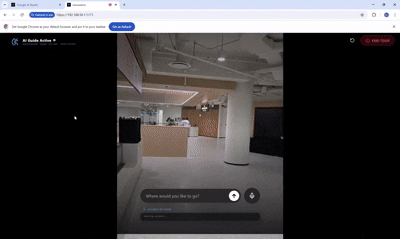

# 🧭 NaviSwarm — AI-Powered Indoor AR Navigation

> **Real-time indoor wayfinding using a multi-agent AI swarm, powered by the Gemini Multimodal Live API.**



NaviSwarm transforms your phone's camera into an intelligent indoor navigation system. Instead of relying on GPS (which fails indoors), NaviSwarm uses a coordinated swarm of AI agents — built on Google's Gemini 2.5 Flash and the Gemini Multimodal Live API — to continuously map your surroundings, understand spatial context, and guide you to your destination with real-time AR directional overlays.

---

## ✨ Key Features

### 🤖 Multi-Agent Swarm Architecture
NaviSwarm deploys specialized AI agents that work in parallel:
- **Scout Agent** — Continuously scans the live camera feed to identify and memorize architectural landmarks (e.g., *"Red Double Doors"*, *"Restroom Sign"*) and hazards (*"Wet Floor"*, *"Broken Elevator"*), building a persistent spatial memory database in real-time.
- **Coordinator Agent** — When the user asks a question (text or voice), this agent cross-references the live camera view with the spatial memory to determine the best action, providing concrete directional commands and AR overlays.

### 🎙️ Gemini Multimodal Live API Integration
- **Real-time voice conversation** — Speak naturally to NaviSwarm and receive instant audio responses via the Gemini Live API with low-latency bi-directional audio streaming.
- **Continuous vision uplink** — Camera frames are streamed to the Live session every second, enabling the AI to reason about what it *currently sees* and what it *remembers* from earlier.
- **Function calling for AR overlays** — The Live API calls an `update_direction` tool to dynamically control the on-screen AR directional arrows (FORWARD, LEFT, RIGHT, TURN_AROUND, ARRIVED) in real-time as the conversation unfolds.

### 🧭 AR Directional Overlay
- Large, animated directional chevrons overlaid on the camera feed guide the user visually.
- Bounding box tracking with a scanning effect highlights target landmarks as waypoints.
- Directions update live — both from text queries (via Gemini 2.5 Flash streaming) and from voice conversations (via Gemini Live function calling).

### 📡 Adaptive Polling with IMU Motion Detection
- NaviSwarm uses the device's IMU (gyroscope/accelerometer) to detect whether the user is moving or stationary.
- When stationary, the Scout Agent pauses API calls to conserve bandwidth and API cost.
- When motion is detected, scanning resumes automatically — delivering a responsive, cost-efficient experience.

### 🗺️ Persistent Spatial Memory
- Landmarks and hazards discovered by the Scout are accumulated in a growing spatial memory database.
- The Coordinator uses this memory to provide wayfinding guidance even when the target is *not currently visible* — suggesting waypoints through remembered landmarks.
- Exploratory guidance is given when a target hasn't been mapped yet (e.g., *"Walk forward to scan more areas"*).

---

## 🏗️ Tech Stack

| Layer | Technology |
|---|---|
| **Frontend** | React 19 + Vite 7 |
| **Styling** | Tailwind CSS 4 + Custom CSS animations |
| **AI / LLM** | Google Gemini 2.5 Flash (vision + text) |
| **Real-time AI** | Gemini Multimodal Live API (bi-directional audio + video streaming) |
| **Camera** | WebRTC `getUserMedia` with multi-camera support |
| **Audio** | Custom `AudioRecorder` (16kHz PCM) + `AudioPlayer` (24kHz) for Live API |
| **Motion Sensing** | Device Orientation API (IMU-based adaptive polling) |
| **Icons** | Lucide React |

---

## 🚀 Getting Started

### Prerequisites
- Node.js 18+
- A valid [Google Gemini API Key](https://aistudio.google.com/apikey)

### Installation

```bash
cd naviswarm
npm install
```

### Configuration

Open `src/App.jsx` and paste your Gemini API key:

```js
const API_KEY = "YOUR_GEMINI_API_KEY";
```

### Run

```bash
npm run dev
```

> **Note:** NaviSwarm requires HTTPS for camera and microphone access. The dev server is configured with `@vitejs/plugin-basic-ssl` to enable local HTTPS. On mobile devices, access the app via your local network IP (e.g., `https://192.168.x.x:5173`).

---

## 🎯 How It Works

```
┌─────────────────────────────────────────────────────┐
│                    USER'S PHONE                     │
│  ┌───────────┐  ┌──────────┐  ┌──────────────────┐  │
│  │  Camera   │  │   IMU    │  │   Microphone     │  │
│  │  Feed     │  │  Motion  │  │   (Live Audio)   │  │
│  └─────┬─────┘  └────┬─────┘  └────────┬─────────┘  │
│        │              │                 │            │
│        ▼              ▼                 │            │
│  ┌───────────────────────┐              │            │
│  │     SCOUT AGENT       │              │            │
│  │  (Gemini 2.5 Flash)   │              │            │
│  │  Continuous mapping   │              │            │
│  │  of landmarks &       │              │            │
│  │  hazards              │              │            │
│  └───────────┬───────────┘              │            │
│              │                          │            │
│              ▼                          ▼            │
│  ┌──────────────────────────────────────────────┐   │
│  │           SPATIAL MEMORY DATABASE             │   │
│  │  landmarks: ["Red Door", "Exit Sign", ...]    │   │
│  │  hazards:   ["Wet Floor", ...]                │   │
│  └──────────────────────┬───────────────────────┘   │
│                         │                            │
│                         ▼                            │
│  ┌──────────────────────────────────────────────┐   │
│  │         COORDINATOR AGENT                     │   │
│  │  (Gemini 2.5 Flash / Gemini Live API)         │   │
│  │  Cross-references live view + memory          │   │
│  │  Returns: MESSAGE + DIRECTION + TARGET        │   │
│  └──────────────────────┬───────────────────────┘   │
│                         │                            │
│                         ▼                            │
│  ┌──────────────────────────────────────────────┐   │
│  │           AR DIRECTIONAL OVERLAY              │   │
│  │  ⬆️ FORWARD  ⬅️ LEFT  ➡️ RIGHT  🔄 TURN      │   │
│  │  + Bounding box tracking on landmarks         │   │
│  └──────────────────────────────────────────────┘   │
└─────────────────────────────────────────────────────┘
```

---

## 📱 Usage

1. **Grant permissions** — Allow camera and microphone access when prompted.
2. **Walk around** — The Scout Agent automatically maps landmarks as you move.
3. **Ask a question** — Type *"Where is the restroom?"* or tap the mic button to speak.
4. **Follow the arrows** — AR directional chevrons guide you toward your goal.
5. **Live mode** — Tap the microphone to start a continuous Gemini Live session for hands-free, real-time voice navigation.

---

## 🏆 Built for the Gemini API Developer Competition

NaviSwarm showcases the power of the **Gemini Multimodal Live API** combined with **Gemini 2.5 Flash's vision capabilities** to solve a real-world problem: indoor navigation without GPS. By combining continuous environment scanning, persistent spatial memory, and real-time AR guidance into a multi-agent architecture — all running in a browser — NaviSwarm demonstrates what's possible when AI can *see*, *remember*, *reason*, and *guide* simultaneously.

---

## 📄 License

MIT